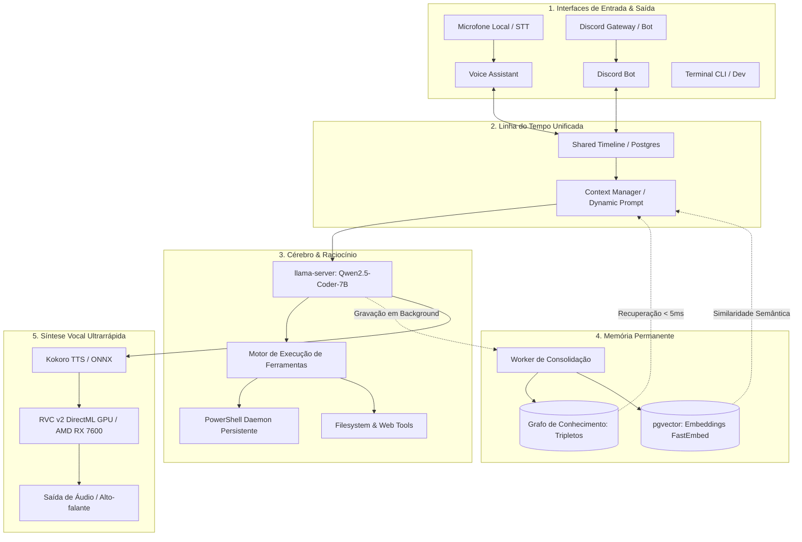

# Project AIGIS — Arquitetura e Engenharia do Sistema

A **Aigis** é um sistema de Inteligência Artificial Pessoal Autônomo com presença contínua e multimodal, projetado para operar localmente no hardware de Natanael (Windows 11, AMD Radeon RX 7600), com consciência de estado, memória de longo prazo e capacidade de ação direta no sistema operacional.

---

## 1. Visão Geral da Arquitetura

O sistema é dividido em **4 pilares fundamentais**:

---

## 2. Módulos do Sistema

### 2.1. Cérebro Local (`core/client.py`)
- **Backend:** `llama-server` (porta `8080`) rodando **Qwen2.5-Coder-7B-Instruct** quantizado em `Q4_K_M`.
- **Modo de Operação:** ReAct (Reasoning + Acting) via OpenAPI Tools nativo e fallback de extração sintática.
- **Hook de Feedback Imediato (`on_tool_start`):** Notifica vocalmente o usuário antes do início de comandos lentos (ex: *"Apagando o arquivo..."*, *"Pesquisando na internet..."*), reduzindo a latência percebida de 15s para ~1.5s.

### 2.2. Interfaces (`interfaces/`)
- **Voz no PC (`interfaces/voice_assistant.py`):**
  - **STT (Speech-to-Text):** Faster-Whisper `small` rodando com detecção de silêncio e parada automática via VAD/energia calibrada.
  - **Áudio de Saída:** Pipeline em dois estágios: Kokoro TTS (síntese base em ~200ms) + RVC v2 da Aigis acelerado via DirectML na AMD Radeon RX 7600.
- **Discord Bot (`interfaces/discord_bot.py`):**
  - Presença contínua no servidor, sincronização de canais e suporte a anexos de imagem.
  - Sincroniza em tempo real com a Sessão Unificada.

### 2.3. Sessão Unificada & Timeline (`core/timeline.py`)
- **Tabela:** `shared_timeline` no PostgreSQL (porta `5433`).
- **Propósito:** Garante que a Aigis lembre e mantenha coerência entre o que o usuário fala no microfone do PC e o que escreve no Discord.
- **Histórico Estruturado:** Grava chamadas e resultados de ferramentas em metadados JSON, permitindo continuidade de comandos entre múltiplos turnos (ex: *"consegue apagar ele de novo?"*).

### 2.4. Motor de Ferramentas (`tools/system.py`)
- **Sessão Persistente PowerShell:** Daemon interativo com `$ErrorActionPreference = 'Stop'`, UTF-8 forçado e sem custo de *cold-start*, executando comandos no Windows em **~14ms** (em vez de ~230ms de um subprocess avulso).
- **Tratamento de Exceções:** Captura real de falhas de caminhos inexistentes e permissões com saída clara de `stderr` e flag `success: false`.

### 2.5. Memória Permanente (`memory/`)
- **Grafo de Conhecimento:** Tripletos relacionais (`sujeito -> predicado -> objeto`) no PostgreSQL para fatos atômicos invariantes (caminhos de projetos, nomes, preferências).
- **Busca Vetorial:** `pgvector` com embeddings `BAAI/bge-small-en-v1.5` gerados via FastEmbed local em CPU/ONNX.
- **Worker Autônomo (`memory/worker.py`):** Processo em background que analisa a timeline e extrai novos fatos sem bloquear a interação do usuário.

---

## 3. Infraestrutura & Portas

| Serviço | Tecnologia | Endereço / Porta | Finalidade |
| :--- | :--- | :--- | :--- |
| **LLM Server** | llama.cpp / llama-server | `http://localhost:8080/v1` | Inferência do modelo neural |
| **Banco de Dados** | PostgreSQL 16 + pgvector | `localhost:5433` (Docker: `ai_assistant_postgres`) | Grafo de conhecimento e timeline |
| **Voz (Kokoro)** | ONNX Runtime | Local / RAM | TTS inicial de alta velocidade |
| **Voz (RVC v2)** | DirectML (`onnxruntime-directml`) | GPU AMD Radeon RX 7600 | Timbre oficial da Aigis |
