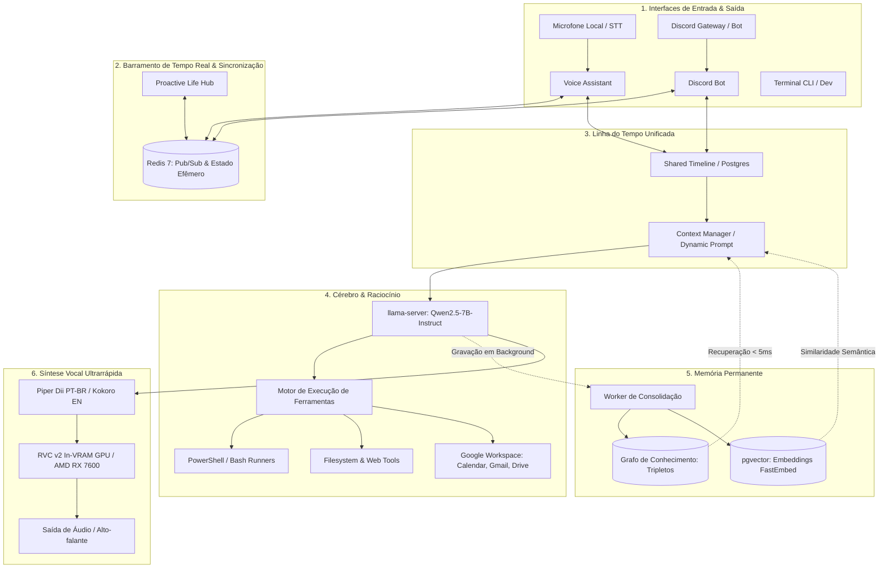

# Project AIGIS — Arquitetura e Engenharia do Sistema

A **Aigis** é um sistema de Inteligência Artificial Pessoal Autônomo com presença contínua e multimodal, projetado para operar localmente no hardware de Natanael (Windows 11, AMD Radeon RX 7600), com consciência de estado, memória de longo prazo e capacidade de ação direta no sistema operacional.

---

## 1. Visão Geral da Arquitetura

O sistema é dividido em **6 pilares fundamentais**:

---

## 2. Módulos do Sistema

### 2.1. Cérebro Local (`core/client.py`)
- **Backend:** `llama-server` (porta `8080`) rodando **Qwen2.5-7B-Instruct** quantizado em `Q4_K_M` com janela de contexto de **8192 tokens**.
- **Modo de Operação:** ReAct (Reasoning + Acting) via OpenAPI Tools nativo e fallback de extração sintática.
- **Roteador Context-Aware (`should_enable_tools`):** Analisa a mensagem atual e turnos recentes da conversa para manter ferramentas ativas em follow-ups naturais (*"conseguiu?"*, *"o que tem nele?"*, *"apague ele"*).
- **Interceptor Anti-Alucinação Ativo:** Impede respostas em texto fingindo ações ou simulando conteúdo de e-mails/arquivos sem chamada de ferramenta correspondente (`verified: true` ou `success: true`), forçando inline a execução de `read_email_body`, `create_calendar_event` ou operadores de sistema.
- **Hook de Feedback Imediato (`on_tool_start`):** Notifica vocalmente o usuário antes do início de comandos lentos (ex: *"Criando o arquivo..."*, *"Lendo e-mail..."*), reduzindo a latência percebida para <50ms.

### 2.2. Interfaces (`interfaces/`)
- **Voz no PC (`interfaces/voice_assistant.py`):**
  - **STT (Speech-to-Text):** Faster-Whisper `small` rodando com pré-roll de áudio e parada automática via VAD/energia calibrada.
  - **Áudio de Saída:** Pipeline híbrido em dois estágios: Piper Dii local (PT-BR) / Kokoro ONNX (EN) + Trato Vocal In-VRAM RVC v2 40kHz da Aigis em PyTorch GPU (AMD Radeon RX 7600 via ROCm/Vulkan ou DirectML).
  - **Normalização Fonética de Anglicismos:** Dicionário com mais de 80 termos técnicos (TypeScript, Python, Docker, Desktop, etc.) adaptados em tempo real para pronúncia natural em prosódia brasileira sem distorções robóticas.
- **Discord Bot (`interfaces/discord_bot.py`):**
  - Presença contínua no servidor com múltiplos canais temáticos dedicados: `#aigis-agenda`, `#aigis-inbox`, `#aigis-feed`, `#aigis-status`.
  - Sincronização em tempo real via Redis e suporte a anexos de arquivos/código.

### 2.3. Sessão Unificada & Timeline (`core/timeline.py`)
- **Tabela:** `shared_timeline` no PostgreSQL (porta `5433`).
- **Propósito:** Garante que a Aigis lembre e mantenha coerência entre o que o usuário fala no microfone do PC e o que escreve no Discord.
- **Histórico Estruturado & Sanitização:** Grava chamadas e resultados de ferramentas em metadados JSON, permitindo continuidade de comandos entre múltiplos turnos, e filtra afirmações não verificadas para evitar contaminação de contexto.

### 2.4. Hub Proativo de Vida & Barramento (`core/proactive_hub.py` & `core/bus.py`)
- **Barramento de Mensagens Redis Pub/Sub:** Sincronização instantânea (<1ms) de eventos entre o processo do Discord, o processo de voz no PC e daemons de background.
- **Lembretes Antecipados de Agenda:** Monitoramento a cada 60s disparando alertas no Discord 15 a 30 minutos antes do início de compromissos com menção do usuário.
- **Triagem Inteligente de Gmail:**
  - Descarte rigoroso de newsletters e marketing via cabeçalhos RFC (`List-Unsubscribe`, `List-Id`) e detecção heurística de remetentes de disparos automatizados.
  - Alertas com priorização visual em `#aigis-inbox` e menção para itens urgentes/importantes.
  - **Deduplicação Persistente em Disco (`data/notified_emails.json`):** Garante tolerância a reinicializações e falhas, impedindo que um e-mail seja notificado mais de uma vez.

### 2.5. Motor de Ferramentas (`tools/system.py`)
- **Google Calendar (`create_calendar_event`, `delete_calendar_event`):** Resolução semântica de dias da semana, suporte a regras de recorrência (`RRULE:FREQ=WEEKLY;BYDAY=...`), coloração temática dinâmica (`colorId`) e exclusão em lote de instâncias duplicadas.
- **Leitura Verificada de E-mails (`read_email_body`):** Extração real do corpo MIME plaintext ou snippet no Gmail por ID ou busca flexível por assunto/urgência, blindada contra alucinações.
- **Google Drive (`search_google_drive`, `read_google_drive_file`):** Consulta de documentos e anotações armazenadas no Drive.
- **Manipulação Verificada de Arquivos (`create_file`, `delete_file`):** Criação e exclusão atômica com validação física no disco (`Path.exists()`) e retorno estruturado (`verified: true`).
- **Sessão Persistente PowerShell (Windows) & Bash (Linux):** Execução isolada com timeout configurável e truncamento inteligente de saída.

### 2.6. Memória Permanente (`memory/`)
- **Grafo de Conhecimento:** Tripletos relacionais (`sujeito -> predicado -> objeto`) no PostgreSQL para fatos atômicos invariantes.
- **Busca Vetorial:** `pgvector` com embeddings gerados via FastEmbed local em CPU/ONNX.
- **Worker Autônomo (`memory/worker.py`):** Processo em background que analisa a timeline e extrai novos fatos sem bloquear a interação do usuário.

---

## 3. Infraestrutura & Portas

| Serviço | Tecnologia | Endereço / Porta | Finalidade |
| :--- | :--- | :--- | :--- |
| **LLM Server** | llama.cpp / llama-server | `http://localhost:8080/v1` | Inferência do modelo neural (Qwen2.5-7B) |
| **Banco de Dados** | PostgreSQL 16 + pgvector | `localhost:5433` (Docker: `ai_assistant_postgres`) | Grafo de conhecimento, vetores e timeline |
| **Barramento & Cache** | Redis 7 | `localhost:6379` (Docker: `ai_assistant_redis`) | Pub/Sub em tempo real e estado efêmero |
| **Google Workspace** | Google APIs OAuth2 | `token.json` local | Calendar, Gmail e Drive |
| **Voz (Piper Dii / Kokoro)** | ONNX Runtime | Local / RAM | TTS inicial de alta velocidade |
| **Voz (RVC v2)** | PyTorch DirectML / ROCm | GPU AMD Radeon RX 7600 | Timbre oficial da Aigis (40kHz) |
