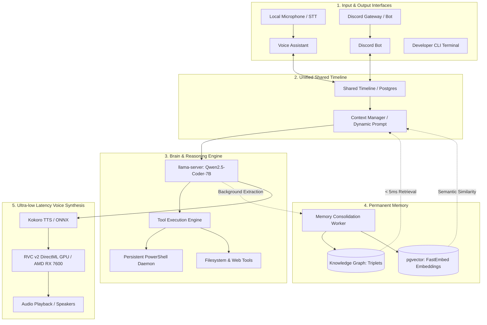

# Project AIGIS — System Architecture & Engineering

**Aigis** is an autonomous, multimodal Personal Artificial Intelligence system designed to operate locally on Natanael's hardware (Windows 11, AMD Radeon RX 7600), featuring state awareness, persistent long-term memory, and direct operating system actuation capabilities.

---

## 1. Architectural Overview

The system is structured around **5 fundamental pillars**:

---

## 2. Core Modules

### 2.1. Local Brain (`core/client.py`)
- **Backend:** `llama-server` (port `8080`) serving **Qwen2.5-Coder-7B-Instruct** quantized in `Q4_K_M`.
- **Reasoning Mode:** ReAct (Reasoning + Acting) via native OpenAPI Tool Schemas with regex syntax extraction fallbacks.
- **Immediate Tool Audio Hook (`on_tool_start`):** Vocally cues the user before starting long-running actions (e.g., *"Deleting file..."*, *"Searching web..."*), reducing perceived latency from ~15s to ~1.5s.

### 2.2. Interfaces (`interfaces/`)
- **PC Voice Assistant (`interfaces/voice_assistant.py`):**
  - **STT (Speech-to-Text):** Faster-Whisper `small` running on CPU/INT8 with calibrated energy VAD and automatic silence cutoffs.
  - **Audio Pipeline:** Two-stage synthesis: Kokoro TTS base speech (~200ms) + RVC v2 neural voice conversion running via DirectML on the AMD Radeon RX 7600 GPU.
- **Discord Bot (`interfaces/discord_bot.py`):**
  - Continuous server presence, channel synchronization, and multimodal image attachment parsing.
  - Live bi-directional sync with the unified timeline.

### 2.3. Unified Session & Timeline (`core/timeline.py`)
- **Storage:** `shared_timeline` table in PostgreSQL (port `5433`).
- **Functionality:** Ensures memory consistency between PC microphone voice commands and Discord chat interactions.
- **Tool Trace Persistence:** Retains full `tool_calls` and execution results within message metadata, enabling context continuity across multiple conversational turns (e.g., pronoun resolution like *"can you delete it again?"*).

### 2.4. Tool Engine (`tools/system.py`)
- **Persistent PowerShell Daemon:** Interactive pipe with `$ErrorActionPreference = 'Stop'`, UTF-8 enforcement, and zero process cold-start penalty, executing Windows commands in **~14ms** (compared to ~230ms per cold subprocess).
- **Error Propagation:** Strict exception capture for non-existent files or unauthorized paths, returning explicit `stderr` and `success: false`.

### 2.5. Permanent Memory (`memory/`)
- **Knowledge Graph:** Relational triplets (`subject -> predicate -> object`) in PostgreSQL for atomic facts (file paths, nicknames, user preferences).
- **Vector Search:** `pgvector` index with `BAAI/bge-small-en-v1.5` dense embeddings computed locally via FastEmbed ONNX.
- **Autonomous Worker (`memory/worker.py`):** Background daemon continuously mining the timeline to consolidate new facts without user latency penalties.

---

## 3. Infrastructure & Services

| Service | Technology | Address / Port | Role |
| :--- | :--- | :--- | :--- |
| **LLM Server** | llama.cpp / llama-server | `http://localhost:8080/v1` | Neural model inference (Qwen2.5-Coder) |
| **Database** | PostgreSQL 16 + pgvector | `localhost:5433` (Docker: `ai_assistant_postgres`) | Knowledge graph, vectors, and shared timeline |
| **Voice (Kokoro)** | ONNX Runtime | Local / RAM | High-speed base phonetic TTS |
| **Voice (RVC v2)** | DirectML (`onnxruntime-directml`) | AMD Radeon RX 7600 GPU | Official Aigis vocal timbre |
