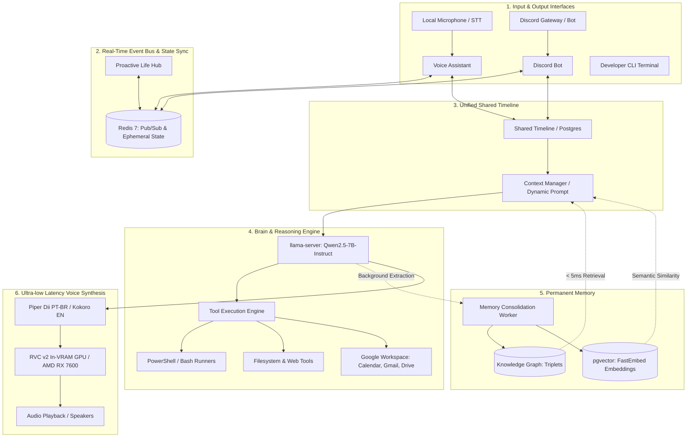

# Project AIGIS — System Architecture & Engineering

**Aigis** is an autonomous, multimodal Personal Artificial Intelligence system designed to operate locally on Natanael's hardware (Windows 11, AMD Radeon RX 7600), featuring state awareness, persistent long-term memory, and direct operating system actuation capabilities.

---

## 1. Architectural Overview

The system is structured around **6 fundamental pillars**:

---

## 2. Core Modules

### 2.1. Local Brain (`core/client.py`)
- **Backend:** `llama-server` (port `8080`) serving **Qwen2.5-7B-Instruct** quantized in `Q4_K_M` with an **8192-token** context window.
- **Reasoning Mode:** ReAct (Reasoning + Acting) via native OpenAPI Tool Schemas with regex syntax extraction fallbacks.
- **Context-Aware Tool Router (`should_enable_tools`):** Evaluates user prompts and conversation turns to keep tools active on continuous follow-ups (*"did you do it?"*, *"what is written inside?"*, *"delete it"*).
- **Active Anti-Hallucination Interceptor:** Rejects conversational claims or fabricated email/file bodies when no corresponding tool execution was verified, inline-forcing `read_email_body`, `create_calendar_event` or OS tools.
- **Immediate Tool Audio Hook (`on_tool_start`):** Vocally cues the user before starting long-running actions (e.g., *"Creating file..."*, *"Reading email..."*), reducing perceived latency to <50ms.

### 2.2. Interfaces (`interfaces/`)
- **PC Voice Assistant (`interfaces/voice_assistant.py`):**
  - **STT (Speech-to-Text):** Faster-Whisper `small` running on CPU/INT8 with calibrated energy VAD and automatic silence cutoffs.
  - **Audio Pipeline:** Hybrid two-stage synthesis: Piper Dii (PT-BR) / Kokoro ONNX (EN) + In-VRAM RVC v2 40kHz PyTorch GPU vocal tract on the AMD Radeon RX 7600 GPU.
  - **Technical Phonetic Normalization:** Over 80 anglicisms phonetically transcribed for natural Portuguese prosody without robotic glitches.
- **Discord Bot (`interfaces/discord_bot.py`):**
  - Continuous server presence with dedicated functional channels: `#aigis-agenda`, `#aigis-inbox`, `#aigis-feed`, `#aigis-status`.
  - Real-time Redis synchronization and multi-turn attachment handling.

### 2.3. Unified Session & Timeline (`core/timeline.py`)
- **Storage:** `shared_timeline` table in PostgreSQL (port `5433`).
- **Functionality:** Ensures memory consistency between PC microphone voice commands and Discord chat interactions.
- **Tool Trace Persistence:** Retains full `tool_calls` and execution results within message metadata, enabling context continuity across multiple conversational turns.

### 2.4. Proactive Life Hub & Event Bus (`core/proactive_hub.py` & `core/bus.py`)
- **Redis Pub/Sub Event Bus:** Instantaneous (<1ms) event synchronization across Discord, PC voice assistant, and background daemons.
- **Agenda Reminders:** Continuous 60-second polling notifying `#aigis-agenda` 15 to 30 minutes ahead of scheduled events with owner pings.
- **Intelligent Gmail Triage:**
  - Automated newsletter and marketing blast pruning via RFC headers (`List-Unsubscribe`, `List-Id`) and heuristic sender analysis.
  - Prioritized visual alerts in `#aigis-inbox` with owner mentions for urgent emails.
  - **Persistent Disk Deduplication (`data/notified_emails.json`):** Bulletproof persistence preventing re-notifications across bot reboots.

### 2.5. Tool Engine (`tools/system.py`)
- **Google Calendar (`create_calendar_event`, `delete_calendar_event`):** Semantic weekday resolution, recurring events (`RRULE:FREQ=WEEKLY;BYDAY=...`), thematic category color coding (`colorId`), and duplicate-safe mass deletion.
- **Verified Email Reading (`read_email_body`):** True plaintext MIME extraction from Gmail via ID or flexible topic/urgency queries, protected by anti-hallucination guardrails.
- **Google Drive (`search_google_drive`, `read_google_drive_file`):** Search and read documents and spreadsheets directly within the user workspace.
- **Filesystem Tools (`create_file`, `delete_file`):** Atomic verified file operations with physical disk confirmation (`verified: true`).
- **Persistent Shell Runners:** Interactive PowerShell daemon (Windows) and isolated Bash runner (Linux) with strict timeout deadlines.

### 2.6. Permanent Memory (`memory/`)
- **Knowledge Graph:** Relational triplets (`subject -> predicate -> object`) in PostgreSQL for atomic facts.
- **Vector Search:** `pgvector` index with dense embeddings computed locally via FastEmbed ONNX.
- **Autonomous Worker (`memory/worker.py`):** Background daemon continuously mining the timeline to consolidate new facts without user latency penalties.

---

## 3. Infrastructure & Services

| Service | Technology | Address / Port | Role |
| :--- | :--- | :--- | :--- |
| **LLM Server** | llama.cpp / llama-server | `http://localhost:8080/v1` | Neural model inference (Qwen2.5-7B) |
| **Database** | PostgreSQL 16 + pgvector | `localhost:5433` (Docker: `ai_assistant_postgres`) | Knowledge graph, vectors, and shared timeline |
| **Event Bus & State** | Redis 7 | `localhost:6379` (Docker: `ai_assistant_redis`) | Real-time Pub/Sub and state management |
| **Google Workspace** | Google APIs OAuth2 | Local `token.json` | Calendar, Gmail, and Drive integrations |
| **Voice (Piper / Kokoro)** | ONNX Runtime | Local / RAM | High-speed base phonetic TTS |
| **Voice (RVC v2)** | PyTorch DirectML / ROCm | AMD Radeon RX 7600 GPU | Official Aigis vocal timbre (40kHz) |
