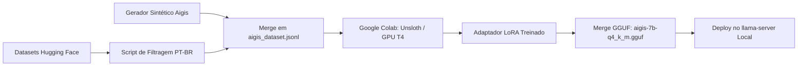

# Project AIGIS — Plano de Fine-Tuning LoRA & Alinhamento de Persona

Este documento detalha o planejamento técnico para o refinamento (*fine-tuning*) do modelo neural da **Aigis** via LoRA, visando naturalidade em Português Brasileiro (PT-BR), alinhamento de persona com o criador e manutenção da precisão no uso de ferramentas (*Tool Calling*).

---

## 1. Justificativa & Diagnóstico do Problema

Atualmente, o cérebro central da Aigis utiliza o **Qwen2.5-Coder-7B-Instruct**. Embora excelente em código e execução de ferramentas, o modelo base apresenta comportamentos indesejados em linguagem natural falada:
- **Respostas Mecânicas / Robóticas:** Uso de chavões de assistente corporativo (ex: *"Entendido, combinado!"*) em situações onde o usuário apenas elogiou ou expressou alívio (*"Boa, deu certo"*).
- **Sobrecarga de Prompt:** Necessidade de dezenas de regras negativas no System Prompt (*"não peça desculpas"*, *"não recite caminhos"*), o que consome contexto e aumenta a latência de processamento de tokens.
- **Dificuldade em Resolver Referências Cruzadas:** Dificuldade em conectar pronomes (*"apaga ele"*) sem que o histórico de chamadas de ferramentas esteja perfeitamente estruturado.

---

## 2. Abordagem: LoRA (Low-Rank Adaptation)

O fine-tuning será realizado via **LoRA** congelando o modelo base e treinando adaptadores de baixo rank (*rank* $r=16$ ou $r=32$, $\alpha=32$):
- **Preservação de Capacidade:** O modelo não perde a habilidade lógica e sintática de gerar scripts PowerShell e comandos.
- **Tamanho do Artefato:** O LoRA final terá entre **30MB e 60MB**, podendo ser fundido (*merged*) diretamente no modelo base para gerar um novo arquivo `.gguf`.

---

## 3. Composição do Dataset (*Dataset Blending*)

O dataset de treinamento será estruturado em 3 camadas de dados:

| Camada | Fonte | Exemplos Estimados | Objetivo Principal |
| :--- | :--- | :--- | :--- |
| **1. Fluência Conversacional PT-BR** | `Canarim-Instruct-PTBR` / `Pt-Corpus-Instruct` (Hugging Face) | ~500 a 800 pares | Diálogos curtos naturais em português brasileiro informal |
| **2. Roleplay & Dinâmica Social** | `agentlans/combined-roleplay` / Curadoria | ~200 a 300 pares | Reações contextuais a elogios, correções, ironias e alívio |
| **3. Persona & Tool Calling Aigis** | Sintético especializado (`training/generate_aigis_data.py`) | ~250 a 400 pares | Identidade com Natanael, chamadas de PowerShell no Windows, feedback de voz conciso |

---

## 4. Pipeline de Treinamento



1. **Compilação:** Unificação dos dados em formato ChatML compatível com Qwen:
   ```json
   {"messages": [{"role": "system", "content": "..."}, {"role": "user", "content": "..."}, {"role": "assistant", "content": "..."}]}
   ```
2. **Treinamento no Colab:** Execução com `unsloth` em GPU gratuita T4/A100 (tempo estimado: 15–20 minutos).
3. **Quantização e Deploy:** Exportação em formato GGUF `Q4_K_M` e substituição no `llama-server`.
