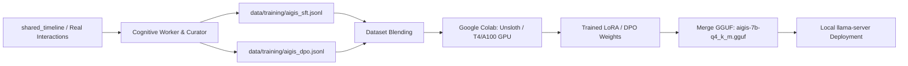

# Project AIGIS — LoRA Fine-Tuning & Persona Alignment Plan

This document outlines the technical strategy for fine-tuning **Aigis's** neural model using LoRA. The objective is to achieve natural conversational flow in Brazilian Portuguese (PT-BR), deep alignment with the creator, and robust tool-calling accuracy.

---

## 1. Problem Statement & Motivation

Currently, Aigis's core cognition runs on **Qwen2.5-Coder-7B-Instruct**. While state-of-the-art for coding and function execution, the base model exhibits conversational deficiencies in spoken dialogue:
- **Mechanical Responses:** Over-reliance on generic corporate assistant clichés (e.g., *"Understood, agreed!"*) when the user is expressing praise or relief (*"Nice, it worked"*).
- **Prompt Bloat:** Excessive negative instructions in the system prompt (*"do not apologize"*, *"do not recite paths"*), inflating prompt evaluation latency and token costs.
- **Reference Resolution:** Difficulty resolving contextual pronouns (*"delete it"*) unless complete structured tool call histories are persistently maintained.

---

## 2. Approach: LoRA (Low-Rank Adaptation)

Fine-tuning will be performed using **LoRA** on the frozen base model, adjusting low-rank adapter matrices ($r=16$ or $r=32$, $\alpha=32$):
- **Capability Preservation:** Prevents catastrophic forgetting of coding logic and PowerShell generation.
- **Artifact Footprint:** The resulting LoRA weighs **30MB–60MB**, which can be dynamically mounted or fused directly into a single `.gguf` binary.

---

## 3. Dataset Composition (*Dataset Blending*) & Continuous Curation

The training corpus combines domain synthetic data with **continuous real-time autonomous curation** managed by `memory/dataset_curator.py` and `memory/worker.py`:

| Layer | Source | Format / Target | Primary Goal |
| :--- | :--- | :--- | :--- |
| **1. Successful Real Dialogues (SFT)** | `memory/dataset_curator.py` | `data/training/aigis_sft.jsonl` | Real timeline interactions between Natanael and Aigis that completed naturally and factually |
| **2. Preference & Correction Pairs (DPO)** | `memory/worker.py` | `data/training/aigis_dpo.jsonl` | Automatic `{prompt, chosen, rejected}` pairs captured whenever Natanael corrects Aigis' mistakes or tone |
| **3. PT-BR Conversational Fluency** | `Canarim-Instruct-PTBR` / Hugging Face | External / Base corpus | Informal Brazilian Portuguese prosody and natural phrasings |
| **4. Aigis Persona & Tool Calling** | Domain Synthetic Generator (`training/generate_aigis_data.py`) | `data/training/synthetic_aigis.jsonl` | Foundational identity, tools, and voice feedback cues |

---

## 4. Continuous Training Pipeline



1. **Compilation:** Standardize into ChatML structure:
   ```json
   {"messages": [{"role": "system", "content": "..."}, {"role": "user", "content": "..."}, {"role": "assistant", "content": "..."}]}
   ```
2. **Training in Colab:** Utilize `unsloth` on free T4/A100 GPU instances (~15–20 min training time).
3. **Quantization & Deployment:** Export GGUF `Q4_K_M` binary directly into local model storage.
