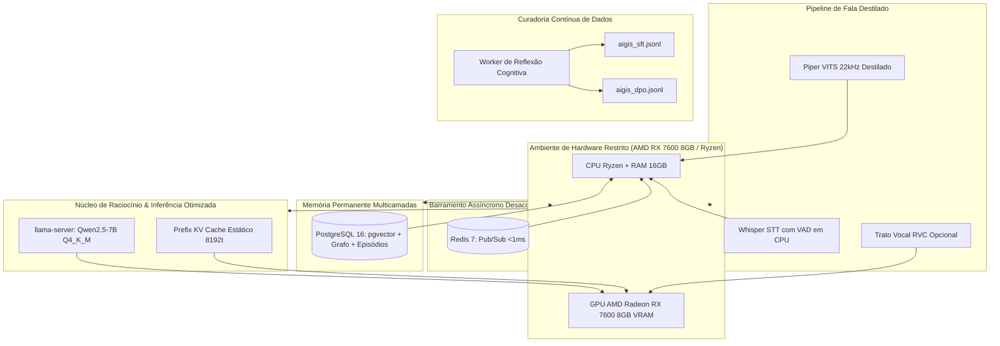

# Proposta de Trabalho de Conclusão de Curso (TCC) / Projeto de Pesquisa Acadêmica

**Instituição:** Universidade Tecnológica Federal do Paraná (UTFPR)  
**Autor:** Natanael Galafassi  
**Área de Concentração:** Inteligência Artificial Aplicada, Engenharia de Software & Sistemas Distribuídos  

---

## 📌 1. Título do Trabalho

### Título Principal:
> **Engenharia de Agentes Autônomos em Hardware de Consumo: Arquitetura Cognitiva com Memória Multicamadas, Alinhamento Contínuo e Execução Local com Recursos Limitados**

### Título Alternativo (Foco em Edge AI):
> **Viabilidade de Agentes Pessoais Multimodais Locais em Hardware Restrito: Desempenho, Memória Autobiográfica e Otimização Sem Nuvem**

---

## 🎯 2. Contextualização e Justificativa

### O Problema da Dependência da Nuvem
Atualmente, a quase totalidade dos assistentes virtuais de inteligência artificial reside na nuvem (OpenAI ChatGPT, Anthropic Claude, Google Gemini). Essa abordagem impõe sérias limitações para a sociedade e para a engenharia de software:
1. **Privacidade e LGPD:** Dados íntimos da rotina do usuário (e-mails, compromissos de agenda, notas de estudo, arquivos de trabalho e comandos de voz) trafegam e residem em servidores corporativos de terceiros.
2. **Custo Recorrente & Lock-in:** Assinaturas mensais caras por usuário e APIs com custo por token que inviabilizam projetos de longo prazo para desenvolvedores independentes e pequenas instituições.
3. **Latência de Rede e Falta de Incorporação Física:** Atrasos de ida e volta (RTT) que prejudicam a fluidez da síntese de voz e a incapacidade dos modelos remotos de atuar diretamente no sistema operacional local.

### O Desafio do Hardware Fraco / Restrito (*Consumer-Grade Hardware*)
A literatura de *Large Language Models* (LLMs) frequentemente presume a disponibilidade de clusters de GPUs corporativas NVIDIA (A100, H100) com 40 a 80 GB de VRAM. No entanto, o cenário real de estudantes, pesquisadores e usuários comuns no Brasil é composto por **computadores de consumo** (processadores AMD Ryzen ou Intel Core, 16 a 32 GB de RAM e placas de vídeo intermediárias, como a AMD Radeon RX 7600 de 8 GB de VRAM).

**A Pergunta de Pesquisa:**  
> *É tecnicamente viável projetar e executar um ecossistema de agente inteligente autônomo, dotado de presença multimodal (voz ultrarrápida e texto), memória permanente contínua e atuadores reais no sistema operacional, operando 100% localmente em hardware de consumo restrito com tempo de resposta humanizado (<1s)?*

---

## 🔬 3. Objetivos do Trabalho

### Objetivo Geral
Projetar, implementar e avaliar experimentalmente uma arquitetura de agente de IA pessoal autônomo multimodal, executada integralmente on-premises em hardware de consumo restrito, investigando o trade-off entre consumo de VRAM/RAM, latência temporal e capacidade de raciocínio.

### Objetivos Específicos
1. **Otimização de Inferência em Hardware Modesto:**
   - Avaliar o impacto da quantização em 4 bits (GGUF `Q4_K_M`) no modelo Qwen 2.5 7B Instruct rodando em GPU AMD via Vulkan/ROCm no `llama-server`.
   - Mensurar a economia de processamento decorrente da **reutilização estática de Prefix KV Cache** na GPU através do desacoplamento do prompt de sistema e injeção dinâmica de contexto na cauda.
2. **Arquitetura de Memória Híbrida e Autobiográfica:**
   - Comparar o desempenho de resgate de contexto entre abordagens ingênuas de RAG puramente vetorial e o modelo hierárquico proposto:
     - Memória Semântica Densa (`pgvector` + FastEmbed ONNX local).
     - Memória Factual Relacional (Grafo de Conhecimento em PostgreSQL).
     - Memória Autobiográfica e Perfil do Usuário (`user_profiles`).
     - Memória Episódica (`episodic_memories`).
3. **Destilação Acústica e Voz Neural em Tempo Real:**
   - Investigar a destilação de conhecimento de voz de um modelo *Teacher* de alta fidelidade (RVC v2 40kHz, que compete por VRAM com a LLM) para um modelo *Student* compacto (Piper VITS 22kHz), permitindo síntese neural expressiva em CPU/Edge com latência inferior a 150ms.
4. **Mineração Autônoma de Dados para Treinamento (SFT / DPO):**
   - Implementar e demonstrar um mecanismo de reflexão em segundo plano que identifica falhas e correções do usuário na linha do tempo, gerando automaticamente datasets de preferências para Direct Preference Optimization (DPO).
5. **Segurança e Anti-Alucinação em Chamadas de Ferramentas (*Tool Calling*):**
   - Avaliar a taxa de sucesso e mitigação de alucinações através de guardrails determinísticos que validam no disco a execução de comandos ReAct antes de emitir respostas ao usuário.

---

## 📐 4. Arquitetura do Sistema Proposta no TCC

---

## 📊 5. Metodologia de Avaliação e Métricas

Para atender ao rigor acadêmico da banca da UTFPR, o trabalho apresentará experimentos quantitativos:

1. **Métricas de Inferência e Recursos:**
   - **TTFT (Time to First Token):** Tempo em milissegundos até a primeira palavra ser gerada.
   - **Throughput de Geração:** Tokens gerados por segundo (tok/s).
   - **Pegada de Memória:** Ocupação de VRAM (MB) comparando FP16 vs Q8_0 vs Q4_K_M.
   - **Impacto do KV Cache:** Latência com prompt caching ativado vs recomputação total a cada turno.
2. **Métricas de Precisão de Ferramentas (Tool Calling):**
   - **Taxa de Execução Verificada:** Porcentagem de comandos executados com sucesso (`verified: true`).
   - **Falsos Positivos de Ação:** Número de alucinações antes vs depois dos guardrails anti-alucinação.
3. **Métricas de Recuperação de Memória:**
   - Comparação da relevância de resgate de fatos após 1, 7 e 30 dias de interações entre RAG tradicional e a Memória Híbrida da Aigis.
4. **Métricas de Síntese Vocal:**
   - **RTF (Real-Time Factor):** Tempo de síntese dividido pela duração do áudio gerado.

---

## 🔄 6. Como Fazer a Transição da sua Proposta Antiga de TCC

Se você já tinha um tema pré-aprovado mas não está empolgado com ele, a troca de proposta é um procedimento **comum e muito bem aceito** na universidade, especialmente quando o novo tema é mais sólido e avançado:

### Por que a Aigis é uma proposta muito superior:
1. **Código já existente e funcional:** Você não começará do zero. O backend, banco de dados, barramento e integrações já existem e foram testados.
2. **Relevância de Mercado e Acadêmica:** IA Local (*Local LLMs / SLMs*), preservação de privacidade e agentes autônomos são exatamente o estado-da-arte que as empresas de tecnologia e a comunidade científica mais buscam hoje.
3. **Engajamento Pessoal:** Desenvolver um TCC sobre algo que você mesmo usa diariamente e que resolve dores reais da sua rotina garante que você terá motivação contínua até a entrega final.

### Roteiro para conversar com o orientador:
1. Agende uma conversa curta de 15 minutos com seu orientador.
2. Explique com transparência: *"Professor(a), estive refletindo sobre o escopo do meu TCC. Paralelamente, venho desenvolvendo um sistema complexo de agente autônomo local com foco em execução em hardware restrito, memória híbrida e otimização de latência, que já possui arquitetura e código funcionais."*
3. Apresente o arquivo [docs/ARCHITECTURE.md](ARCHITECTURE.md) e este documento de proposta ([docs/TCC_RESEARCH_PROPOSAL.md](TCC_RESEARCH_PROPOSAL.md)).
4. Demonstre a assistente em funcionamento: nenhum orientador recusa um aluno que já tem um protótipo avançado pronto para ser submetido a baterias de testes metodológicos.

---

## 📚 7. Referências Bibliográficas Preliminares

1. **Yao, S. et al.** (2022). *ReAct: Synergizing Reasoning and Acting in Language Models*. arXiv:2210.03629.
2. **Park, J. S. et al.** (2023). *Generative Agents: Interactive Simulacra of Human Behavior*. In Proceedings of the 36th Annual ACM Symposium on User Interface Software and Technology (UIST '23), Stanford University / Google Research.
3. **Rafailov, R. et al.** (2023). *Direct Preference Optimization: Your Language Model is Secretly a Reward Model*. In Advances in Neural Information Processing Systems (NeurIPS 2023), Stanford University.
4. **Kim, J. et al.** (2021). *Conditional Variational Autoencoder with Adversarial Learning for End-to-End Text-to-Speech (VITS)*. In International Conference on Machine Learning (ICML 2021).
5. **Dettmers, T. et al.** (2023). *QLoRA: Efficient Finetuning of Quantized LLMs*. In Advances in Neural Information Processing Systems (NeurIPS 2023).
6. **Gerganov, G.** (2023). *llama.cpp: Port of Facebook's LLaMA model in C/C++ for efficient CPU and consumer-GPU inference*. GitHub repository.
