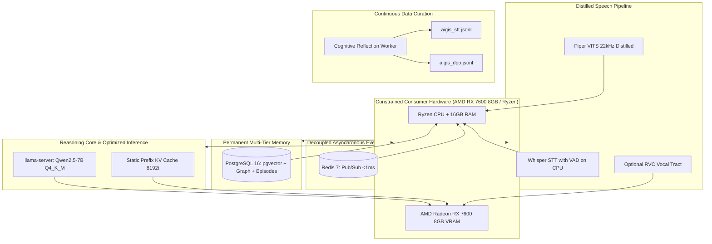

# Academic Research & Capstone Proposal (TCC)

**Institution:** Federal University of Technology – Paraná (UTFPR)  
**Author:** Natanael Galafassi  
**Research Areas:** Applied Artificial Intelligence, Software Engineering & Distributed Systems  

---

## 📌 1. Title

### Primary Title:
> **Autonomous Agent Engineering on Consumer-Grade Hardware: Cognitive Architecture with Multi-Tier Memory, Continuous Alignment, and Resource-Constrained Local Execution**

### Alternative Title (Edge AI Focus):
> **Feasibility of Local Multimodal Personal AI Agents on Constrained Hardware: Performance, Autobiographical Memory, and Cloudless Optimization**

---

## 🎯 2. Context & Motivation

### The Problem of Cloud Dependency
Currently, almost all conversational and autonomous AI assistants depend entirely on proprietary cloud infrastructure (OpenAI ChatGPT, Anthropic Claude, Google Gemini). This model imposes severe constraints on both users and software engineering:
1. **Privacy & Data Protection (LGPD/GDPR):** Sensitive personal workflows (emails, academic deadlines, code repositories, private thoughts, and voice recordings) travel to and reside on third-party servers.
2. **Recurring Financial Overhead & Vendor Lock-in:** Expensive per-seat monthly subscriptions and token-metered APIs make long-term independent research and small-scale deployments economically precarious.
3. **Network Latency & Lack of Local Grounding:** Network round-trip times (RTT) hinder natural voice interactions, while remote cloud models cannot reliably act directly on the user's local operating system without exposing fragile webhooks.

### The Challenge of Resource-Constrained Consumer Hardware
Much of the cutting-edge Large Language Model (LLM) research implicitly assumes access to enterprise-grade NVIDIA GPU clusters (A100, H100) with 40 to 80 GB of VRAM. Conversely, the vast majority of software engineering students, researchers, and everyday developers in Brazil and globally operate **consumer-tier desktop machines** (AMD Ryzen or Intel Core processors, 16–32 GB RAM, and mid-range GPUs such as the AMD Radeon RX 7600 with 8 GB of VRAM).

**The Core Research Question:**  
> *Is it technically viable to design and deploy an autonomous, multimodal intelligent agent (real-time voice + text), equipped with continuous autobiographical memory and verified operating system actuation, running 100% locally on constrained consumer hardware with human-level response latency (<1s)?*

---

## 🔬 3. Research Objectives

### General Objective
Design, implement, and empirically evaluate a local multimodal autonomous AI agent architecture deployed entirely on consumer-grade hardware, systematically measuring trade-offs across VRAM/RAM utilization, latency, and reasoning capability.

### Specific Objectives
1. **Inference Optimization on Constrained Hardware:**
   - Quantify the impact of 4-bit GGUF quantization (`Q4_K_M`) on Qwen 2.5 7B Instruct running on an AMD GPU via Vulkan/ROCm inside `llama-server`.
   - Measure compute savings achieved by **static Prefix KV Cache reuse** in GPU VRAM by decoupling static system prompts from dynamic tail-injected cognitive context.
2. **Multi-Tier Autobiographical Memory Architecture:**
   - Benchmark retrieval accuracy and speed between naive vector-only RAG and the proposed hierarchical model:
     - Dense Semantic Memory (`pgvector` + local ONNX FastEmbed).
     - Relational Knowledge Graph (atomic triplets in PostgreSQL).
     - Sociopsychological User Profiling (`user_profiles`).
     - Episodic Interaction Memory (`episodic_memories`).
3. **Acoustic Distillation for Low-Latency Neural Voice:**
   - Investigate acoustic knowledge transfer from a high-fidelity *Teacher* model (RVC v2 40kHz, which competes for VRAM with the LLM) to a lightweight *Student* model (Piper VITS 22kHz), enabling expressive neural speech on CPU/Edge with sub-150ms acoustic latency.
4. **Autonomous Training Data Curation (SFT / DPO):**
   - Implement an asynchronous background reflection worker that identifies conversational failures and user corrections on the timeline, automatically assembling preference pairs for Direct Preference Optimization (DPO).
5. **Safety and Deterministic Anti-Hallucination in Tool Calling:**
   - Evaluate verified tool execution rates and eliminate hallucinated OS actions through post-execution filesystem checks.

---

## 📐 4. System Architecture

---

## 📊 5. Evaluation Methodology & Metrics

To satisfy UTFPR capstone committee standards, the work will provide empirical benchmarks:

1. **Inference & Resource Metrics:**
   - **TTFT (Time to First Token):** Latency in milliseconds to generate the first token.
   - **Generation Throughput:** Tokens generated per second (tok/s).
   - **VRAM Footprint:** Memory allocation (MB) across FP16 vs Q8_0 vs Q4_K_M.
   - **KV Cache Impact:** Latency comparing cached prefix prompts against full recomputation.
2. **Tool Execution Accuracy:**
   - **Verified Execution Rate:** Percentage of tool calls verified on disk (`verified: true`).
   - **Hallucination Mitigation Rate:** Action errors before vs after deterministic guardrails.
3. **Memory Retrieval Relevance:**
   - Fact recall precision after 1, 7, and 30 days of real-world interactions comparing baseline RAG against Aigis Multi-Tier Memory.
4. **Vocal Synthesis Performance:**
   - **RTF (Real-Time Factor):** Synthesis time divided by audio duration.

---

## 📚 6. Preliminary Academic References

1. **Yao, S. et al.** (2022). *ReAct: Synergizing Reasoning and Acting in Language Models*. arXiv:2210.03629.
2. **Park, J. S. et al.** (2023). *Generative Agents: Interactive Simulacra of Human Behavior*. UIST '23, Stanford University / Google Research.
3. **Rafailov, R. et al.** (2023). *Direct Preference Optimization: Your Language Model is Secretly a Reward Model*. NeurIPS 2023, Stanford University.
4. **Kim, J. et al.** (2021). *Conditional Variational Autoencoder with Adversarial Learning for End-to-End Text-to-Speech (VITS)*. ICML 2021.
5. **Dettmers, T. et al.** (2023). *QLoRA: Efficient Finetuning of Quantized LLMs*. NeurIPS 2023.
6. **Gerganov, G.** (2023). *llama.cpp: Port of Facebook's LLaMA model in C/C++ for efficient CPU and consumer-GPU inference*. GitHub repository.
